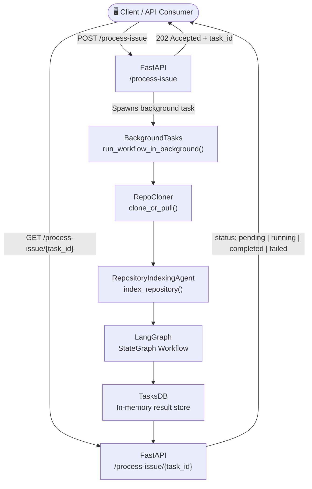
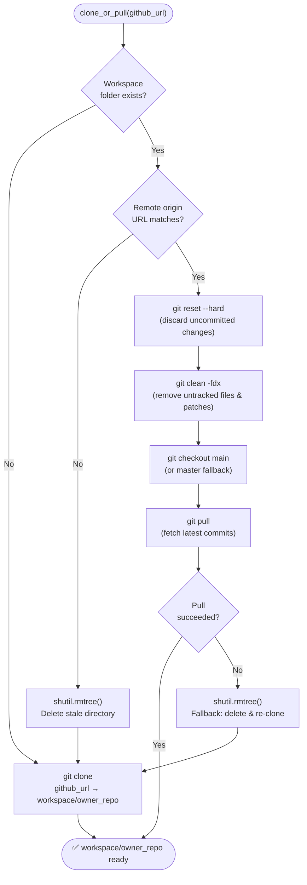
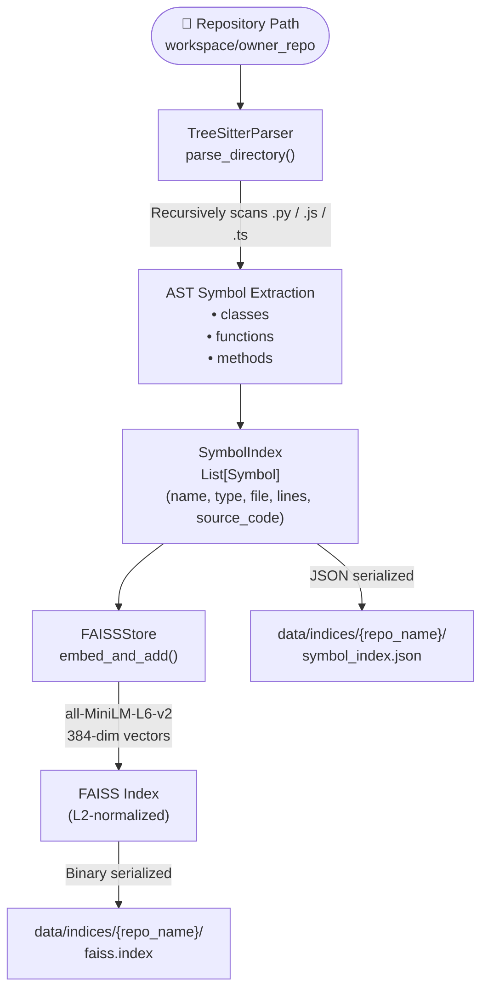
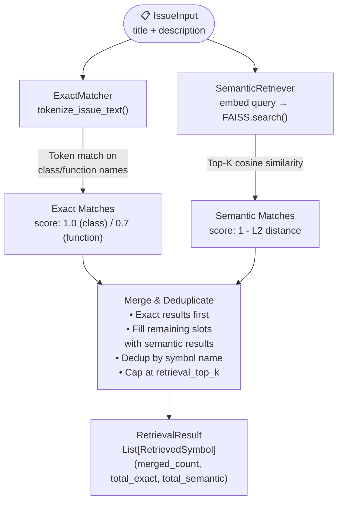
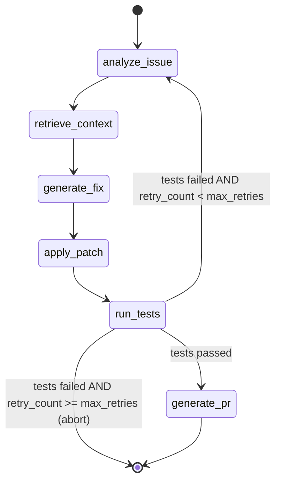
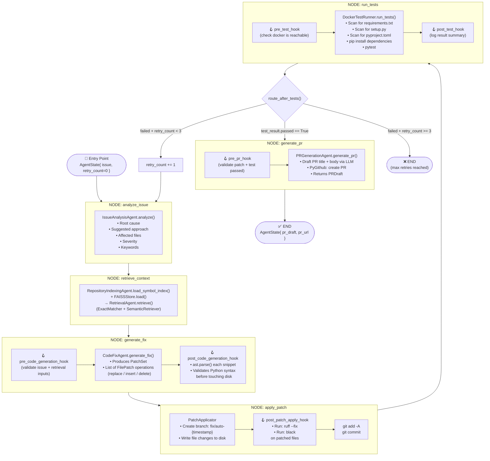
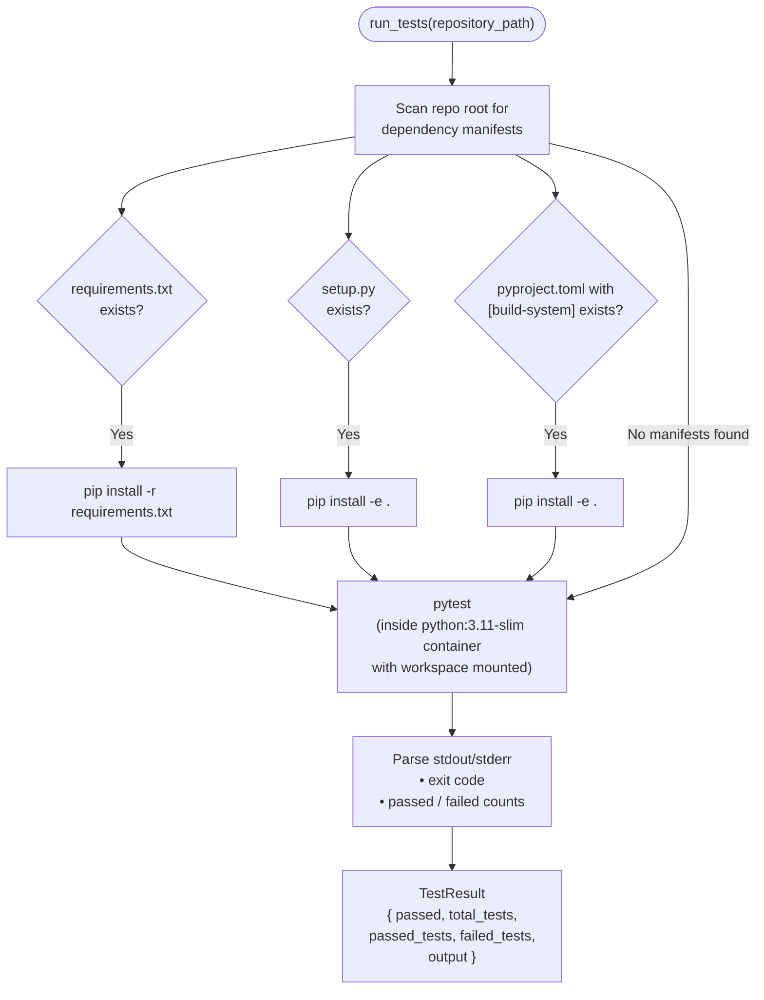
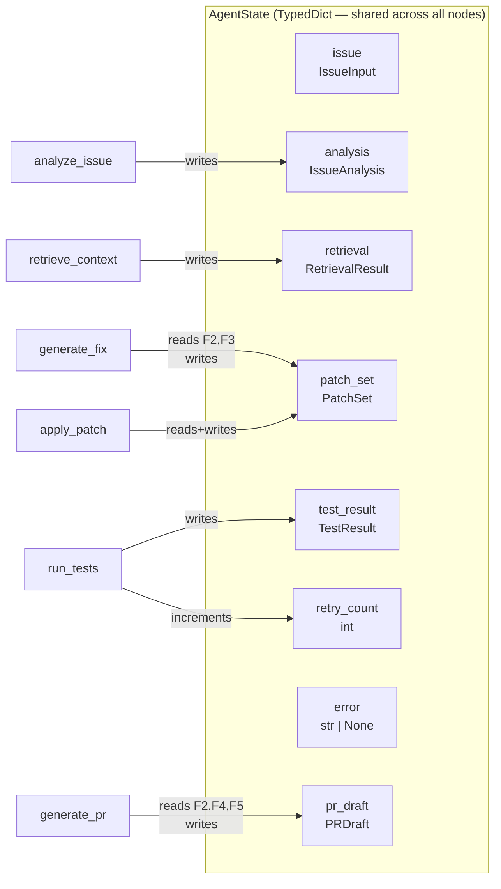

# Architecture Diagrams

---

## 1. End-to-End System Flow

---

## 2. Git Workspace Manager — Clone / Pull Logic

---

## 3. Indexing Pipeline — Tree-Sitter + FAISS

---

## 4. Hybrid Retrieval Engine

---

## 5. LangGraph State Machine — Full Agent Orchestration

---

## 6. LangGraph Node Detail — Hooks & Agents

---

## 7. Docker Sandbox Test Runner

---

## 8. Shared Agent State — Data Flow

